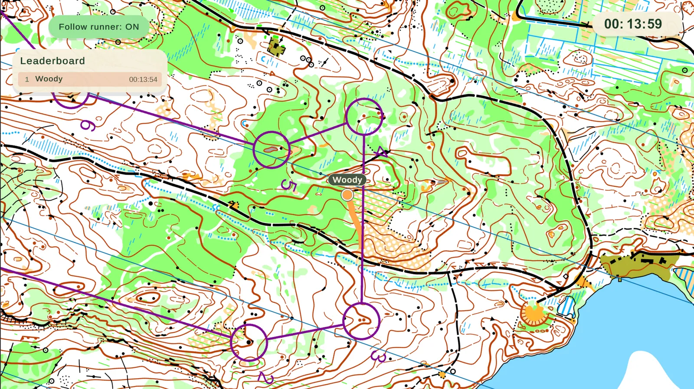
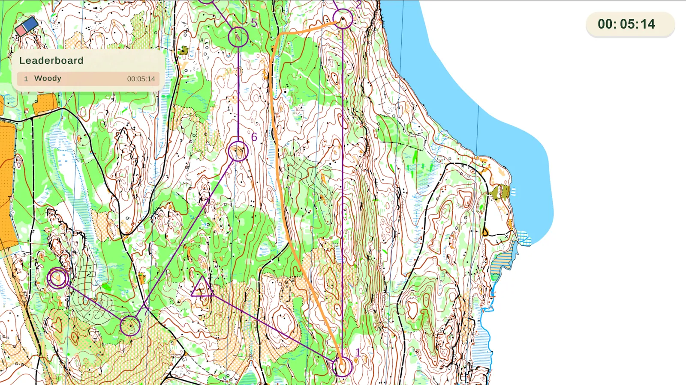
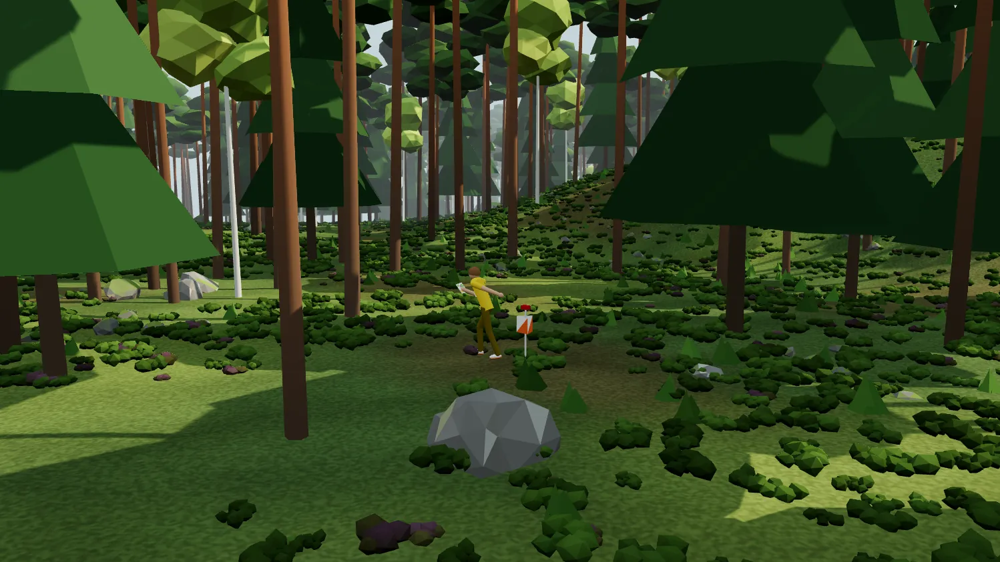
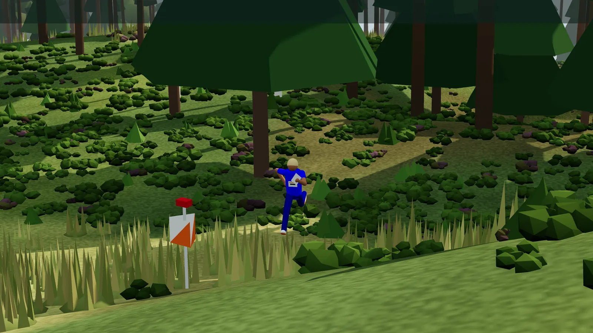
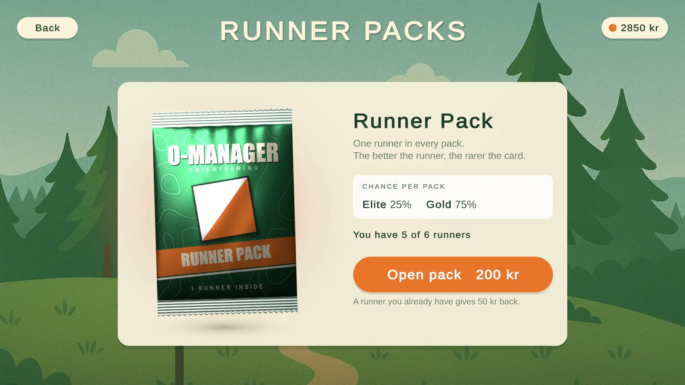
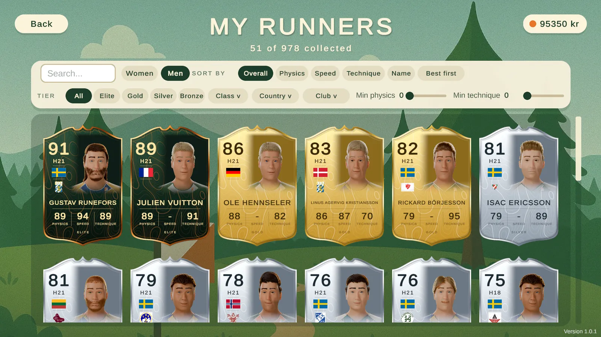
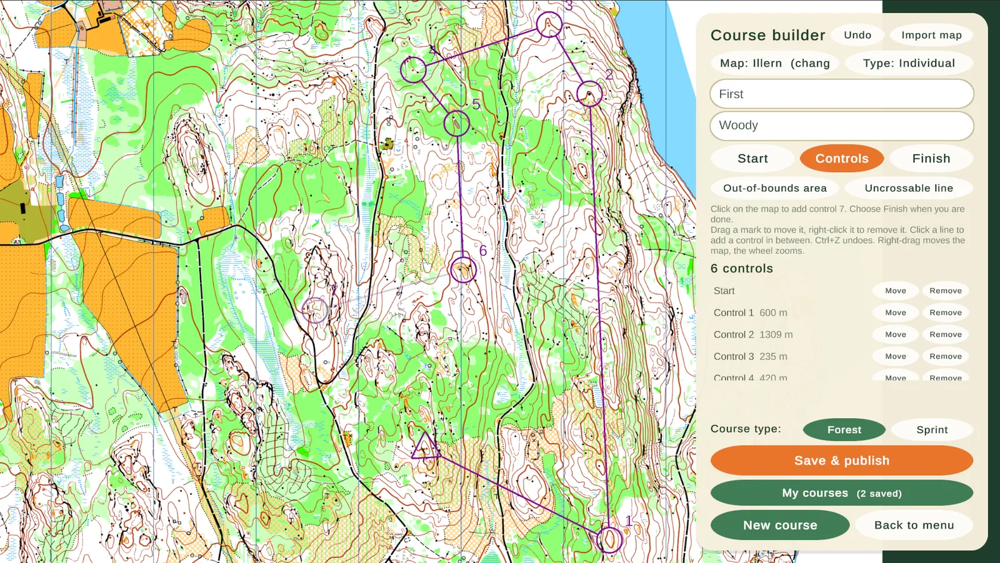
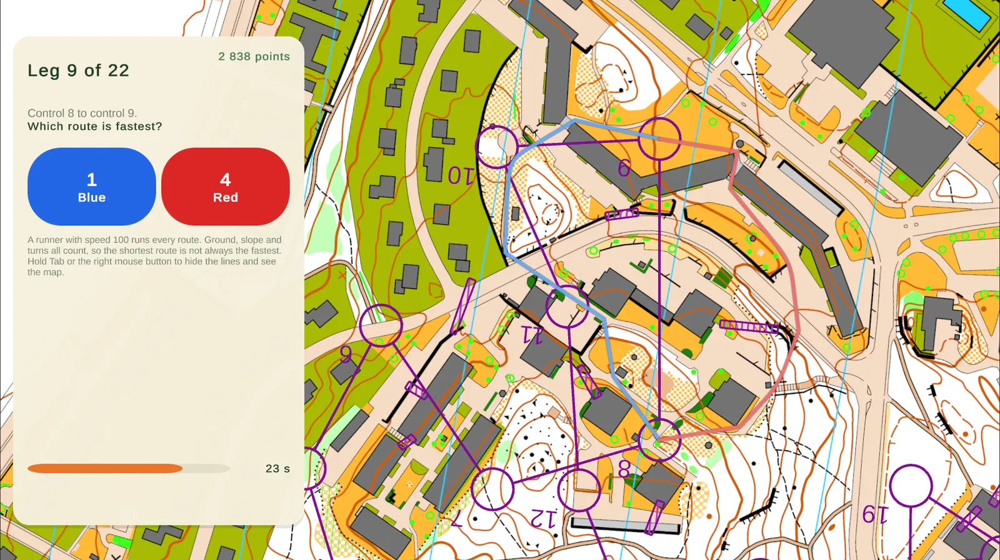
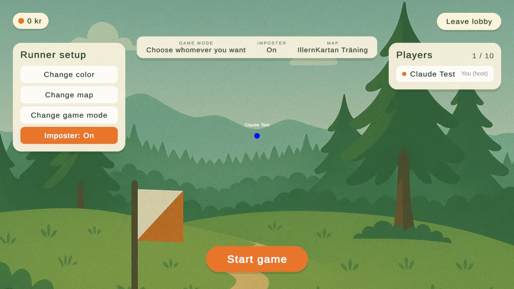
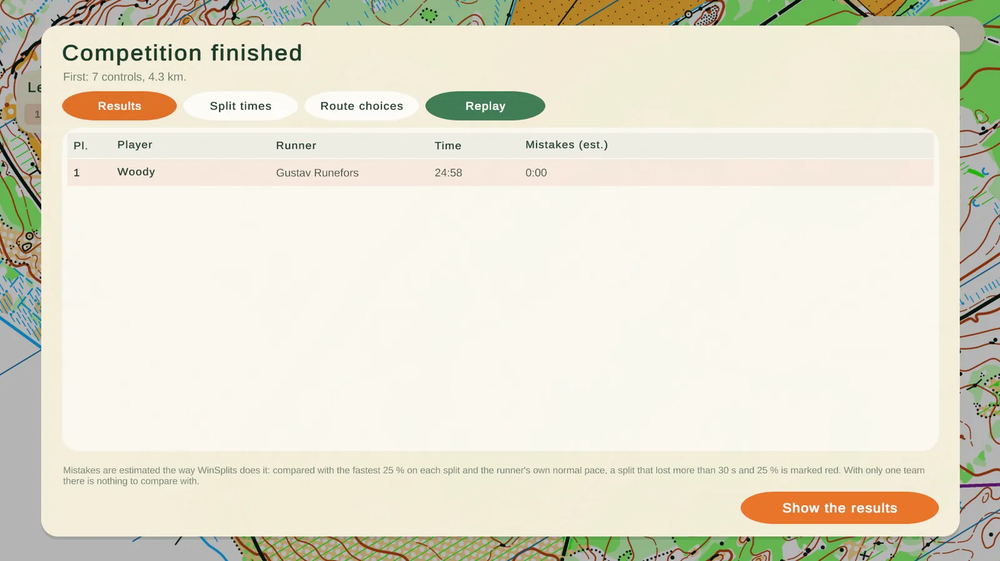

# O-Manager

**O-Manager is an orienteering game.** Most of the time you are the manager: you read a real orienteering map, draw the route your runner should take between the controls, and then watch your runner try to follow it against the clock, alone or against friends online. And when you want to, you can step into the map and run the course yourself in 3D.

Website and download: **[o-manager.se](https://o-manager.se)**

## How a race works

1. **Pick a map and a course.** The maps are real orienteering maps. Courses are set by players in the course builder, or by the game's own course setter.
2. **Pick a runner card.** Every runner has a physical rating, a technique rating and a sprint speed.
3. **Draw your route choice.** Straight through the forest, round on the path, over the hill or along the marsh: the line you draw is the route your runner takes.
4. **Watch the race.** The runner's speed depends on the terrain under their feet (paths, open land, thick green forest, marsh, stony ground), the slope, fatigue and the runner's own stats. Weaker technique means more mistakes: the runner can lose contact with the map, drift off the route and has to relocate.

## What's in the game

- **Multiplayer** for friends in an online lobby, and single player against your own best times.
- **Run it yourself in 3D.** The map is built into a 3D world and you run the course in first person with the map in your hand: a forest on forest maps, a town with houses, walls and people on sprint maps. Alone, or online with individual or mass start, and the usual split times and replay afterwards.
- **Weekly and daily contests.** Every week six contests (route choice game, race and 3D run, each in the forest and on a sprint map) and every day three, on random maps and AI courses. Everyone gets one try, the leaderboard opens after your own run, and you can watch the top three's routes. The best win special runner packs, the rest win money.
- **Relays** with forked courses, chasing starts and a stats screen with a replay after every leg.
- **Live TV production of relays**: the map becomes a 3D forest at chosen controls, and the race slows down to real running pace while the cameras film the runners punching, with split times on screen.
- **Game modes** that can be combined: hide a bear that scares the other runners, move one of their controls, an imposter mode where one player secretly works against the others, and a route choice game where you compare your route with the fastest one.
- **Route analysis** after the race: everyone's routes and split times side by side.
- **Runner cards and packs.** Earn money in races, open packs with a reveal animation, and build your collection in My Runners. The ratings are computed from real race results, and the tiers are fixed: Elite 90+, Gold 80+, Silver 70+, Bronze below. The shop pack has fixed odds per tier (Elite 1 %); the Weekly pack and Daily pack from the contests only hold Silver, Gold and Elite.
- **Course builder** for your own courses, with out-of-bounds areas, forks for relays and an AI course setter that can make a course in any part of a map.
- **Map import** from OCAD and OpenOrienteering Mapper files: the game reads the map symbols and builds a terrain grid that tells how fast it is to run in every few metres of the map, for both forest and sprint maps.

| | |
| --- | --- |
|  |  |
|  |  |
|  |  |
|  |  |

## Built with

- **Unity 6** and **C#**, 2D with 3D worlds for the TV production and for running it yourself.
- **Photon Fusion** for online multiplayer (shared mode, synced race clock, game settings chosen by the host).
- **A\* pathfinding** on a terrain grid with direction-dependent slope costs, used both for the runners and for checking the drawn routes.
- **Map import pipeline** that reads OCAD/OMAP symbol sets (forest and sprint standards) and turns them into speed grids, ground types for the runners' map reading, passages through fences and walls, tunnels and bridges, and a 3D world for the TV cameras.
- **Simulated orienteering**: fatigue, terrain and slope models, and realistic mistakes that depend on how hard the map is to read.
- **Runner ratings** computed in Python from real race results, with times normalized between races.
- **Unity Cloud Save** for shared courses and maps, and a **Cloud Code** script for the weekly and daily contests (one try each, leaderboards, prizes and clean-up after the contest is over).
- A self-updating installer for Windows, macOS and Linux, and a static website.

O-Manager is a hobby project by Anders Skoglund.
